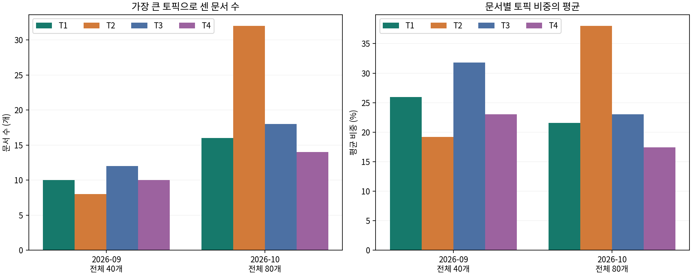

# 04 시기별 변화

분모는 각 월의 유효 문서 수입니다. 같은 모델의 토픽을 비교했습니다.

|월|토픽|전체 문서|최다 토픽 문서 수|평균 비중|
|---|---|---:|---:|---:|
|2026-09|T1|40|10|25.9%|
|2026-09|T2|40|8|19.2%|
|2026-09|T3|40|12|31.8%|
|2026-09|T4|40|10|23.0%|
|2026-10|T1|80|16|21.6%|
|2026-10|T2|80|32|38.0%|
|2026-10|T3|80|18|23.0%|
|2026-10|T4|80|14|17.4%|

## 관찰과 해석
숫자로 관찰한 변화 한 문장과 원문으로 설명한 변화 한 문장을 작성하세요.
같은 단어가 시기별로 다른 입장에 쓰였는지 evidence.csv의 period와 원문을 함께 읽으세요.